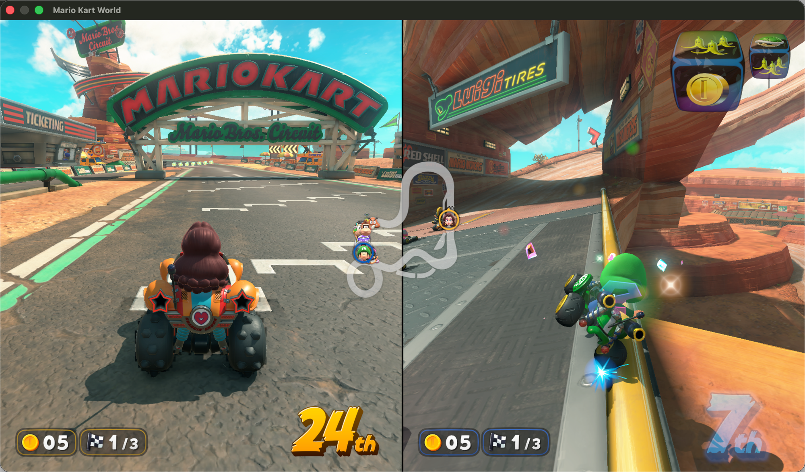
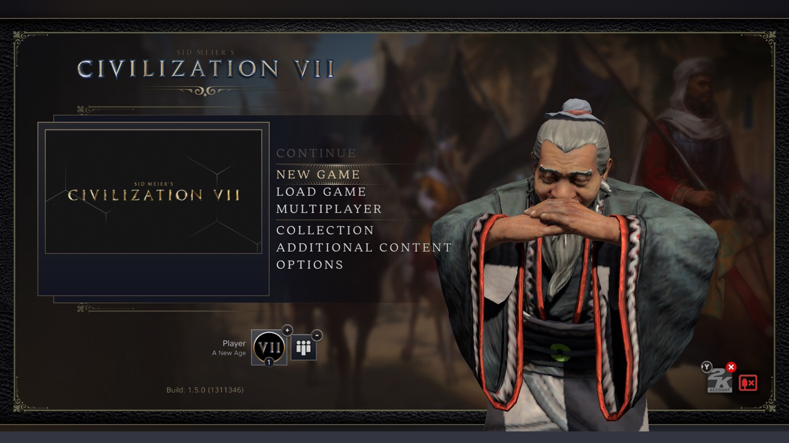
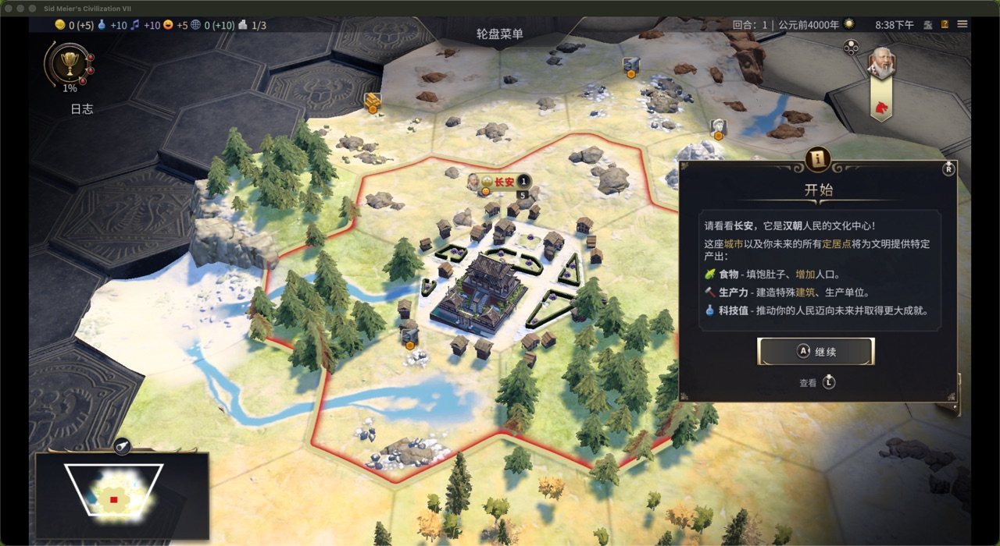

# nxnative tutorial — run a Switch game on your iPhone

[中文](README.md) | [English](README.en.md)

A step-by-step companion to [nxnative](https://github.com/seedds/nxnative), the project that runs Nintendo Switch games **natively** on Apple platforms: the game's own code executes on the Mac/iPhone, on a host that answers Horizon's system calls and implements the Switch's graphics APIs (NVN, Vulkan, NVIDIA's desktop OpenGL) on Metal.

This walkthrough takes a game you own from NSP files to a playable app on your iPhone — including every pitfall hit on a real install (Mario Kart 8 Deluxe 4.0.1 → iPhone 17 Pro, iOS 27.2), and what fixed each one. **Switch 2 games** build and play too — from a `.nup` file or a game dump, no `prod.keys` — Mac-verified so far ([Switch 2 games](#switch-2-games-nup-or-a-dump) below).

> **Use your own games.** You need NSP files and `prod.keys` dumped from your own console. Nothing here distributes games, keys or firmware. Don't share your `prod.keys` — the build only reads it and never prints its values.

**Three real problems this guide solves:**

- **A 9.9 GB IPA won't install** (the phone reports `PackageExtractionFailed`) → `--romfs separate` shrinks the IPA to about 1 GB, and the game image is pushed into the app sandbox separately. See steps 1 and 3.
- **Shader compilation is about 10x slower on an external exFAT drive** → put the build working directory on the internal APFS disk. See the troubleshooting table.
- **Sideloadly appends a team ID to the bundle ID on iOS 27** → look up the real ID with `devicectl` before pushing the image. See step 3.

Mac only? Use `--platform mac-app`; no iPhone needed.

## Which games work?

- **The [games table](https://github.com/seedds/nxnative#readme) in nxnative lists every validated title** — 90+ games, from *Breath of the Wild* and *Tears of the Kingdom* to Mario Kart 8 Deluxe, Pokémon, Metroid Dread, Silksong and Hades II. Each has a tested profile and a note describing what it needed.
- **Switch 2 titles** (program IDs starting `0400…`) are in the same table: *Donkey Kong Bananza*, *Splatoon Raiders*, *Fire Emblem Fortune's Weave*, *Pokémon Pokopia*, *Hyrule Warriors: Age of Imprisonment*, *Mario Kart World*, *Mario Tennis Fever*. They are **Mac-verified** (reached real gameplay on a Mac); iPhone and iPad are untested for them.
- **A game not in the table** still builds: the script surveys its binary (`<title ID>_survey/survey.md`), guesses a provisional profile, and produces a best-effort IPA **that may not boot** — bringing up a new title is real work (see nxnative's `docs/agents`).
- The same flow also works **on the Mac alone**: `--platform mac-app` packs a double-clickable `.app`, no iPhone needed at all.

## Prerequisites

| Tool | Notes |
|---|---|
| [nxnative](https://github.com/seedds/nxnative) cloned | all commands run at the repository root |
| Apple-silicon Mac, Xcode | the Metal compiler must match nxnative's toolchain lock (see its `docs/development.md`) |
| Python 3.12+ | with `lz4`, `capstone`, `fonttools` (and `backports.zstd` before 3.14); `pip install nsz` only if your files are NSZ/XCZ |
| xcodegen, .NET SDK 10, zstd | on `PATH` |
| One game's NSPs | base game, optional update and DLC, in one folder |
| `prod.keys` | from your own console |
| [Sideloadly](https://sideloadly.io) | signs and installs the IPA with an Apple ID |
| Apple ID | a free one works: 3 apps, re-sign every 7 days; a paid account lasts a year |
| iPhone + USB cable | Developer Mode enabled (one-time, see troubleshooting #3) |

**Disk layout tip:** keep the NSPs and the finished IPA wherever you like, but keep the build's work folder (`<title ID>_build/`) on the internal APFS disk. An exFAT external drive makes the shader stage ~10× slower (one `metal` invocation per shader, tens of thousands of small files).

## The 30-second version

```bash
# 1. Build — small IPA + separate game image (mandatory for games over ~4 GB)
python3 scripts/build_ipa_from_nsp.py /path/to/game-nsps -k /path/to/prod.keys \
  --romfs separate -o /path/to/Game.ipa
#    (the build prints the exact push_romfs.sh command at the end)

# 2. Install Game.ipa with Sideloadly (your Apple ID)

# 3. Push the game files into the app's sandbox
xcrun devicectl device info apps --device <UDID>          # find the real bundle ID
bash scripts/push_romfs.sh <UDID> <bundle ID> /path/to/<titleID>_build/extract/<version>/RomFS.img
```

A first build takes 2 minutes (*Metroid Dread*) to 10 (*Breath of the Wild*); a rebuild with unchanged inputs about 20 seconds. On the phone, budget the game's size twice-ish: the IPA (~1 GB) plus the game image (Mario Kart 8 Deluxe: 11.3 GB).

## Switch 2 games (`.nup` or a dump)

A Switch 2 game is built from **one NUP container** (a `.nup` file) or **a folder of the game's files** — not from NSPs. **Neither needs `prod.keys`**: a dump folder with `exefs/` and `romfs/` directly in it counts as the base game, and the same script accepts it as-is:

```bash
python3 scripts/build_ipa_from_nsp.py /path/to/game-dump-folder \
  --romfs separate -o /path/to/Game.ipa      # no -k: a dump needs no keys
```

What differs from a Switch 1 build, and what to expect:

- **Title IDs start `0400…`** (Switch 1 base games are `0100…`). An update dump (e.g. Mario Kart World 1.8.0, v917504) packs from a profile *derived* from the base game's — its fixes apply to the builds they were found on, so a Mac boot-and-play check of the update itself is the first thing to do.
- **SDK 21.x and NVN2**: the device API asks 231.x, shaders are Ampere machine code (sm86, 128-bit instructions) translated by the same chain. A build of a big title is long — Mario Kart World: 11,603 shaders, ~34 min on an M1 Pro.
- **Bigger memory**: Switch 2 heaps are large (Mario Kart World asks 7.47 GiB); 16 GB Macs handle it.
- **Mac-first**: every Switch 2 title in the table was validated on the Mac — validate there before any iPhone attempt (iPhone memory limits are the open question). To play interactively: run the host with `DM_WINDOW=1`, and **`DM_AUDIO=1`** — on the Mac the host defaults to a *silent* sink (iOS defaults to sound). Keyboard: WASD stick, J/K/U/I = A/B/X/Y, Q/E = L/R, arrows = D-pad. Keep the **save folder on internal APFS** (save transactions use `clonefile`; an exFAT save dir mounts read-only).
- **Controllers (Mac)**: every gamepad with a **complete control layout** is its own player (8BitDo Ultimate verified, = player 1); the keyboard always plays as player 1. **A single Joy-Con pairs over Bluetooth but is never used** — without the D-pad and L/ZL it isn't a complete layout, and the host logs `no extended gamepad profile: not used`. To play with Joy-Cons, connect **both** at once (macOS merges the pair into one full controller); two-player split-screen needs two complete-layout gamepads.
- **Dump archives**: Switch 2 dumps travel as multi-part RARs, and many are **RAR6 with the new compression method** — 7-Zip (7zz) silently leaves those entries 0 bytes ("Unsupported Method"). Use RARLAB's `unrar` 7.2+ to extract, and check a few files' sizes before building.

*Verified on a Switch 2 title 2026-11-07: Mario Kart World 1.8.0 (v917504, SDK 21.4.0) from a dump folder → first boot to the title, menus, Grand Prix and a full race of Mario Bros. Circuit on an M1 Pro (1,283 draws a frame in-race, ~30–60 fps).*



*Two-player split-screen on Mario Bros. Circuit, Pauline / Yoshi (2026-11-07, Mac host window mode).*





*Civilization VII (v1.5.0) on the Mac host: the main menu, and turn 1 with the Chang'an start (2026-11-07).*

2026-11-08 update: [Highlight/placement investigation and CFG fix (Chinese)](civ7-highlight-fix.zh-CN.md), with code and screenshots. Map hover and Granary placement outlines are verified; the specific city-purchase screen remains unverified.

## Step 1 — Build the IPA

```bash
python3 scripts/build_ipa_from_nsp.py /path/to/game-nsps \
  -k /path/to/prod.keys \
  --romfs separate \
  -o /path/to/Game.ipa \
  --progress lines
```

What happens: the NSPs are identified by title ID and matched to the game's profile, extracted, their code modules rewritten where Apple's kernel requires it, the shaders translated to Metal, and everything packed with Xcode. Every intermediate lands under `<title ID>_build/` in the NSP folder; the shader cache makes rebuilds fast and survives interruptions.

Useful options:

| Option | What it does |
|---|---|
| `--romfs separate` | keeps the game files out of the IPA (see below) — always use it for iPhone installs |
| `-p v327680` | pack a specific version (default: newest update in the folder) |
| `-l zh-Hans` | game language; change later without a rebuild via `DM_LANG` in the app's `Documents/env.txt` |
| `--app-name`, `--bundle-id` | home-screen name and bundle ID |
| `--allow-other-metal` | proceed when your Xcode's Metal compiler differs from the tested one (read nxnative's note on issue #242 first) |
| `--platform mac-app` | build a double-clickable Mac `.app` instead of an IPA |
| `--survey-only` | just analyze an unknown game |

**Why `--romfs separate`:** iOS's installer never sees archives beyond ~4 GB (App Store's ceiling), and a bundled IPA of a big game is zip64 with a single 10+ GB file inside — the phone reports `PackageExtractionFailed` every time. Separating gives a ~1 GB IPA plus the raw game image, which step 3 copies straight into the app's sandbox.

## Step 2 — Install with Sideloadly

Open Sideloadly, drop in the IPA, sign with your Apple ID, install. Two things to know:

- **If login fails** with `SSLError(SSLEOFError)` against `gsa.apple.com`: Sideloadly ships an old OpenSSL whose TLS handshake gets reset on some networks (a direct China Unicom line does this deterministically; system `curl` still works, so "curl is fine" proves nothing). Route it through a proxy — enable a system proxy and Sideloadly picks it up. The `Fake2-Anisette download failed` warning is harmless.
- **On iOS 26+/27, Sideloadly appends your team ID to the bundle ID**: `org.nxnative.<titleID>` becomes `org.nxnative.<titleID>.<TEAMID>`. That's the ID step 3 needs.

## Step 3 — Push the game files

The app carries the identity of the image it was built for (`romfs.id`) and only accepts a `Documents/romfs.img` that matches — so install the app first, then push once:

```bash
# find the real (team-suffixed) bundle ID
xcrun devicectl device info apps --device <UDID> | grep nxnative

# push (phone unlocked, Developer Mode on)
bash scripts/push_romfs.sh <UDID> <bundle ID> \
  "/path/to/<titleID>_build/extract/<version>/RomFS.img"
```

`push_romfs.sh` copies the image as one file into the app's data container. An interrupted copy is never used (the app checks the image's identity), so just rerun after a failure.

## Day-to-day

- **Every 7 days** (free Apple ID): the signature expires — reinstall the same IPA with Sideloadly. The game files stay; nothing to re-push.
- **Re-push only when the game or version changes** — a new build of the same version keeps the same image identity.
- **Plays with a controller** paired to the iPhone.

## Troubleshooting

| Symptom | Cause → fix |
|---|---|
| Sideloadly login `SSLError(SSLEOFError)` | old OpenSSL fingerprint reset on-path → enable a system proxy |
| Phone: `PackageExtractionFailed` | IPA is zip64 / >4 GB → rebuild with `--romfs separate` |
| No *Developer Mode* toggle on the phone | hidden until the phone pairs with Xcode once (Window → Devices and Simulators), then Settings → Privacy & Security → Developer Mode → on → reboot |
| Build stops on a Metal compiler `[RED]` line | compiler ≠ tested one → `--allow-other-metal` (or install the matching Xcode) |
| `The Xcode build system has crashed`, repeatedly | build folder moved between disks; stale absolute paths → `rm -rf <titleID>_build/ipa/build/ios/pkg/dd`, rebuild |
| Shader stage crawling (hours) | work folder on exFAT → move `<titleID>_build/` to internal APFS (carry `shader/` along; a resumed build restores finished shaders) |
| `devicectl` device `unavailable` | phone locked → unlock |
| `push_romfs.sh`: app not found | wrong bundle ID → look it up with `device info apps`; Sideloadly added your team ID |
| `devicectl device install app` of Sideloadly's big IPA: file not found | Sideloadly purges its signing cache on quit — not a real path; install the small separate IPA instead |
| Switch 2 dump: files come out 0 bytes with 7zz | RAR6's new compression method (`v6:m1`) — 7-Zip can't decode it → extract with RARLAB `unrar` 7.2+ |
| Switch 2 dump: build/survey says files are missing | same RAR6 issue, `exefs/*` is always compressed → verify sizes after extraction |
| Mac run: no sound | the Mac host defaults to a silent sink → launch with `DM_AUDIO=1` |
| Mac run: saves rejected / read-only (`clonefile` `[RED]`) | save dir on exFAT → point it at internal APFS |
| Mac run: a single Joy-Con pairs but the game ignores it | the host only uses complete-layout gamepads; half a Joy-Con is skipped (log: `no extended gamepad profile: not used`) → connect both Joy-Cons (macOS merges them into one) or use a full-layout gamepad |

## The files in this folder

- `README.md` (Chinese, default) / `README.en.md` (English) — this tutorial.
- `assets/` — screenshots used in the READMEs (Mario Kart World split-screen, Civilization VII menu and turn 1, …).
- `scripts/build_ipa_from_nsp.py`, `scripts/push_romfs.sh` — the two nxnative scripts this tutorial drives, copied here **for reading** (MIT, see `scripts/LICENSE`). They resolve paths relative to the nxnative tree, so run them from a clone of [nxnative](https://github.com/seedds/nxnative), not from this folder.
- `LICENSE` — this repository's MIT license.
- `SKILL.md` — the same walkthrough as a Claude Code skill (below).

## Use this as a Claude Code skill

`SKILL.md` turns this tutorial into an agent skill: Claude runs the build, looks up the device and bundle ID, and drives the push.

```bash
git clone https://github.com/leyizong/nxnative-tutorial-skill
ln -s "$(pwd)/nxnative-tutorial-skill" ~/.claude/skills/nxnative-tutorial
```

Then in any session: "把马里奥赛车编译装到手机" / "build and install this Switch game on my iPhone".

---

*Verified end-to-end 2026-11-01: Mario Kart 8 Deluxe 4.0.1 (base 1.0.0 US + update + DLC) → 1004 MB IPA + 11.3 GB image → iPhone 17 Pro, iOS 27.2. Switch 2, 2026-11-07: Mario Kart World 1.8.0 from a dump folder → full race on an M1 Pro (Mac; iPhone untested).*
