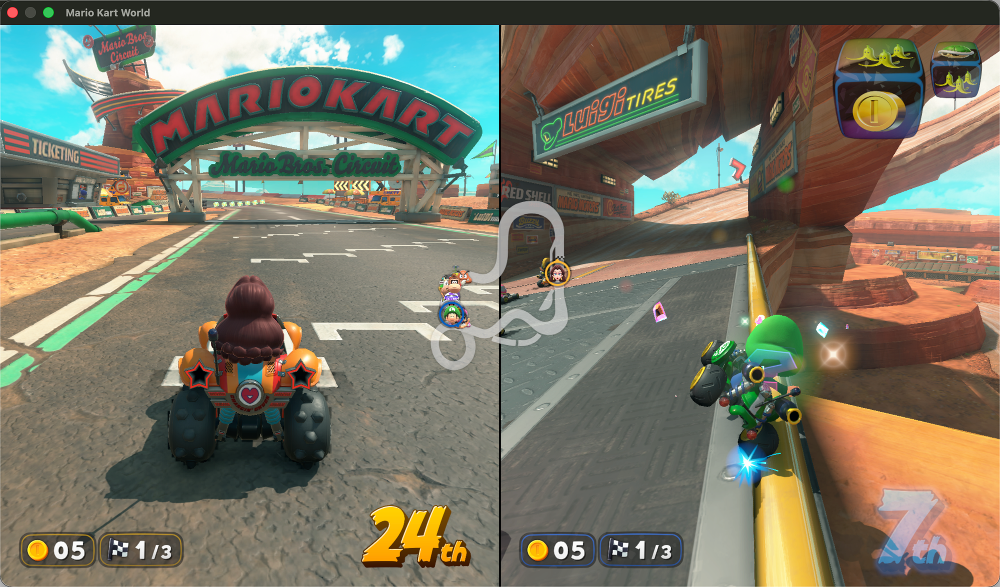

# nxnative 教程 —— 在 iPhone 上运行 Switch 游戏

[中文](README.md) | [English](README.en.md)

[nxnative](https://github.com/seedds/nxnative) 的实操配套教程。nxnative 让 Nintendo Switch 游戏**原生**运行在苹果平台上：游戏自己的代码在 Mac/iPhone 上执行，由一个宿主环境应答 Horizon 的系统调用，并在 Metal 上实现 Switch 的图形 API（NVN、Vulkan、NVIDIA 桌面版 OpenGL）。

本教程带你把一款自己拥有的游戏从 NSP 文件变成 iPhone 上可玩的应用 —— 包含一次真实安装（马里奥赛车8豪华版 4.0.1 → iPhone 17 Pro，iOS 27.2）踩过的所有坑和对应解法。**Switch 2 游戏**也能构建和游玩 —— 从 `.nup` 文件或游戏 dump 构建，无需 `prod.keys` —— 目前已在 Mac 上验证（见下文[Switch 2 游戏](#switch-2-游戏nup-或-dump)）。

> **只用自己的游戏。**你需要从自己主机 dump 出来的 NSP 文件和 `prod.keys`。本教程不分发游戏、密钥或固件。不要分享你的 `prod.keys` —— 构建过程只读取它，永不打印其内容。

**English:** A step-by-step companion to [nxnative](https://github.com/seedds/nxnative), the project that runs Nintendo Switch games **natively** on Apple platforms: the game's own code executes on the Mac/iPhone, on a host that answers Horizon's system calls and implements the Switch's graphics APIs (NVN, Vulkan, NVIDIA's desktop OpenGL) on Metal.

This walkthrough takes a game you own from NSP files to a playable app on your iPhone — including every pitfall hit on a real install (Mario Kart 8 Deluxe 4.0.1 → iPhone 17 Pro, iOS 27.2), and what fixed each one. **Switch 2 games** build and play too — from a `.nup` file or a game dump, no `prod.keys` — Mac-verified so far. Full English version: [README.en.md](README.en.md).

## 哪些游戏能玩？

- **nxnative 的[游戏表](https://github.com/seedds/nxnative#readme)列出所有已验证的游戏** —— 90+ 款，从《旷野之息》《王国之泪》到马里奥赛车8豪华版、宝可梦、密特罗德 生存恐惧、空洞骑士 丝之歌、哈迪斯 II。每款都有测试过的 profile 和一份说明它需要什么的笔记。
- **Switch 2 游戏**（程序 ID 以 `0400…` 开头）也在同一张表里：《森喜刚 蕉奇篇》《斯普拉遁 战士》《火焰之纹章 ~运势之织物~》《宝可梦 波克皮亚》《塞尔达无双 被囚禁的灾厄》《马里奥赛车 世界》《马力欧网球 狂热》。均为 **Mac 已验证**（在 Mac 上跑到真实游戏内容）；iPhone/iPad 尚未测试。
- **不在表里的游戏**也能构建：脚本会调查它的二进制（生成 `<title ID>_survey/survey.md`）、猜测一个临时 profile，产出一个尽力而为的 IPA —— **可能开不了机**；调通一个新游戏是真正的工作量（见 nxnative 的 `docs/agents`）——[《文明 7》一天调通全记录](civ7.zh-CN.md)就是这条路线的完整实例。
- 同样的流程**纯 Mac 也能走**：`--platform mac-app` 打包出双击即玩的 `.app`，完全不需要 iPhone。

## 前置条件

| 工具 | 说明 |
|---|---|
| 克隆的 [nxnative](https://github.com/seedds/nxnative) | 所有命令在仓库根目录执行 |
| Apple 芯片 Mac、Xcode | Metal 编译器必须匹配 nxnative 的工具链锁定版本（见其 `docs/development.md`） |
| Python 3.12+ | 需 `lz4`、`capstone`、`fonttools`（3.14 之前还需 `backports.zstd`）；文件是 NSZ/XCZ 才需要 `pip install nsz` |
| xcodegen、.NET SDK 10、zstd | 在 `PATH` 上 |
| 某一款游戏的 NSP | 本体、可选的更新和 DLC，放在同一个文件夹 |
| `prod.keys` | 来自你自己的主机 |
| [Sideloadly](https://sideloadly.io) | 用 Apple ID 给 IPA 签名并安装 |
| Apple ID | 免费账号即可：3 个应用、每 7 天重签；付费账号一年一签 |
| iPhone + USB 线 | 已开启开发者模式（一次性，见排查表第 3 条） |

**磁盘布局提示**：NSP 和成品 IPA 放哪都行，但构建工作目录（`<title ID>_build/`）要放在内置 APFS 盘上。exFAT 外置盘会让着色器阶段慢约 10 倍（每个着色器一次 `metal` 调用，几万个小文件）。

## 30 秒版本

```bash
# 1. 构建 —— 小 IPA + 分离的游戏镜像（超过 ~4 GB 的游戏必须如此）
python3 scripts/build_ipa_from_nsp.py /path/to/game-nsps -k /path/to/prod.keys \
  --romfs separate -o /path/to/Game.ipa
#    （构建结束时会把确切的 push_romfs.sh 命令打印出来）

# 2. 用 Sideloadly 安装 Game.ipa（你的 Apple ID）

# 3. 把游戏文件推进应用的沙盒
xcrun devicectl device info apps --device <UDID>          # 查真实 bundle ID
bash scripts/push_romfs.sh <UDID> <bundle ID> /path/to/<titleID>_build/extract/<version>/RomFS.img
```

首次构建 2 分钟（《密特罗德 生存恐惧》）到 10 分钟（《旷野之息》）；输入不变的重复构建约 20 秒。手机上按游戏体积的两倍左右留空间：IPA（约 1 GB）加游戏镜像（马里奥赛车8豪华版：11.3 GB）。

## Switch 2 游戏（`.nup` 或 dump）

Switch 2 游戏从**一个 NUP 容器**（`.nup` 文件）或**游戏文件文件夹**构建 —— 不用 NSP。**两者都不需要 `prod.keys`**：直接含 `exefs/` 和 `romfs/` 的 dump 文件夹就算本体，同一个脚本直接接受：

```bash
python3 scripts/build_ipa_from_nsp.py /path/to/game-dump-folder \
  --romfs separate -o /path/to/Game.ipa      # 不带 -k：dump 不需要密钥
```

与 Switch 1 构建的差异，以及预期：

- **标题 ID 以 `0400…` 开头**（Switch 1 本体是 `0100…`）。更新版的 dump（如马里奥赛车 世界 1.8.0，v917504）从本体游戏**派生**的 profile 打包 —— 已知的修复只作用于发现它们的构建版本，所以先在 Mac 上把更新版本身跑起来验证是第一件事。
- **SDK 21.x 与 NVN2**：设备 API 请求 231.x，着色器是 Ampere 机器码（sm86，128 位指令），由同一条链翻译。大作构建时间不短 —— 马里奥赛车 世界：11,603 个着色器，M1 Pro 上约 34 分钟。
- **内存更大**：Switch 2 的堆很大（马里奥赛车 世界请求 7.47 GiB）；16 GB 的 Mac 撑得住。
- **先在 Mac 上验证**：表里的每款 Switch 2 游戏都是在 Mac 上验证的 —— 尝试 iPhone 之前先在 Mac 上过一遍（iPhone 内存上限是悬而未决的问题）。想直接玩：以 `DM_WINDOW=1` 启动宿主，并加 **`DM_AUDIO=1`** —— Mac 上宿主默认是*静音*输出（iOS 默认有声）。键盘：WASD 摇杆、J/K/U/I = A/B/X/Y、Q/E = L/R、方向键 = 十字键。**存档目录放内置 APFS**（存档事务要用 `clonefile`；exFAT 上的存档目录会以只读挂载）。
- **手柄（Mac）**：每个具备**完整键位布局**的 HID 手柄各算一个独立玩家（8BitDo Ultimate 已验证，= player 1），键盘固定并入 1P。**单个 Joy-Con 能连上蓝牙但不会被使用** —— 缺十字键/L/ZL，不构成完整布局，宿主日志会写 `no extended gamepad profile: not used`。要用 Joy-Con 需左右**同时**连接（macOS 会把一对合并成一个完整手柄）；双人分屏需要两个完整布局手柄。
- **dump 压缩包**：Switch 2 dump 常以多卷 RAR 传播，其中不少是**新压缩方法的 RAR6** —— 7-Zip（7zz）会把这些条目悄悄解成 0 字节（"Unsupported Method"）。用 RARLAB 的 `unrar` 7.2+ 解压，构建前抽查几个文件大小。

*Switch 2 游戏验证，2026-11-07：马里奥赛车 世界 1.8.0（v917504，SDK 21.4.0）从 dump 文件夹构建 → M1 Pro 上首次启动到标题画面、菜单、Grand Prix 并完整跑了一场马里奥兄弟赛道（比赛每帧 1,283 次 draw，约 30–60 fps）—— 这是该更新版本在全球范围内的首次运行。*



*双人分屏：马里奥兄弟赛道，Pauline / Yoshi（2026-11-07，Mac 宿主窗口模式）。*

## 第 1 步 —— 构建 IPA

```bash
python3 scripts/build_ipa_from_nsp.py /path/to/game-nsps \
  -k /path/to/prod.keys \
  --romfs separate \
  -o /path/to/Game.ipa \
  --progress lines
```

过程：NSP 按标题 ID 识别并匹配游戏的 profile，解包、在 Apple 内核要求处重写代码模块、把着色器翻译成 Metal，最后用 Xcode 打包。所有中间文件在 NSP 文件夹的 `<title ID>_build/` 下；着色器缓存让重复构建很快，且中断可续。

常用选项：

| 选项 | 作用 |
|---|---|
| `--romfs separate` | 游戏文件不进 IPA（见下）—— iPhone 安装一律用它 |
| `-p v327680` | 打包指定版本（默认：文件夹里最新的更新） |
| `-l zh-Hans` | 游戏语言；之后可免重构建修改：应用 `Documents/env.txt` 里的 `DM_LANG` |
| `--app-name`、`--bundle-id` | 主屏名称和 bundle ID |
| `--allow-other-metal` | 本机 Xcode 的 Metal 编译器与测试过的不同时继续（先读 nxnative 对 issue #242 的说明） |
| `--platform mac-app` | 构建双击即玩的 Mac `.app` 而非 IPA |
| `--survey-only` | 只分析一款未知游戏 |

**为什么用 `--romfs separate`：**iOS 安装器永远见不到超过 ~4 GB 的档案（App Store 的上限），大游戏一体打包的 IPA 是 zip64 且内含单个 10+ GB 文件 —— 手机必然报 `PackageExtractionFailed`。分离后得到约 1 GB 的 IPA 加原始游戏镜像，第 3 步直接把镜像拷进应用沙盒。

## 第 2 步 —— 用 Sideloadly 安装

打开 Sideloadly，拖入 IPA，用你的 Apple ID 签名安装。两点须知：

- **登录失败**报 `SSLError(SSLEOFError)`（gsa.apple.com）：Sideloadly 自带老版 OpenSSL，其 TLS 握手在部分网络上会被重置（联通直连必然如此；系统 `curl` 仍能通，所以"curl 没问题"说明不了什么）。走代理即可 —— 开系统代理，Sideloadly 会自动使用。`Fake2-Anisette download failed` 警告无害。
- **iOS 26+/27 上 Sideloadly 会在 bundle ID 后追加你的团队 ID**：`org.nxnative.<titleID>` 变成 `org.nxnative.<titleID>.<TEAMID>`。第 3 步需要的是后者。

## 第 3 步 —— 推送游戏文件

应用带着构建时镜像的身份（`romfs.id`），只接受身份匹配的 `Documents/romfs.img` —— 所以先装应用，再推一次：

```bash
# 查真实（带团队后缀）的 bundle ID
xcrun devicectl device info apps --device <UDID> | grep nxnative

# 推送（手机解锁、开发者模式已开）
bash scripts/push_romfs.sh <UDID> <bundle ID> \
  "/path/to/<titleID>_build/extract/<version>/RomFS.img"
```

`push_romfs.sh` 把镜像作为单个文件拷入应用数据容器。中断的拷贝永远不会被使用（应用校验镜像身份），失败后重跑即可。

## 日常使用

- **每 7 天**（免费 Apple ID）：签名过期 —— 用 Sideloadly 重装同一个 IPA。游戏文件不动，无需重推。
- **只在游戏或版本变化时重推** —— 同一版本的重新构建镜像身份不变。
- 支持与 iPhone 配对的手柄游玩。

## 排查表

| 症状 | 原因 → 解法 |
|---|---|
| Sideloadly 登录 `SSLError(SSLEOFError)` | 老 OpenSSL 指纹被在线重置 → 开系统代理 |
| 手机报 `PackageExtractionFailed` | IPA 是 zip64 / 超 4 GB → 用 `--romfs separate` 重建 |
| 手机上没有*开发者模式*开关 | 与 Xcode 配对一次前是隐藏的（Window → Devices and Simulators），然后 设置 → 隐私与安全性 → 开发者模式 → 开 → 重启 |
| 构建停在 Metal 编译器 `[RED]` 行 | 编译器 ≠ 测试版本 → `--allow-other-metal`（或装匹配的 Xcode） |
| `The Xcode build system has crashed` 反复出现 | 构建目录跨盘移动，绝对路径失效 → `rm -rf <titleID>_build/ipa/build/ios/pkg/dd` 后重建 |
| 着色器阶段极慢（数小时） | 工作目录在 exFAT 上 → 把 `<titleID>_build/` 挪到内置 APFS（带上 `shader/`；续跑会恢复已完成的着色器） |
| `devicectl` 设备 `unavailable` | 手机锁屏 → 解锁 |
| `push_romfs.sh`：找不到应用 | bundle ID 不对 → 用 `device info apps` 查；Sideloadly 加了你的团队 ID |
| 用 devicectl 装 Sideloadly 的大 IPA：文件不存在 | Sideloadly 退出时清掉签名缓存 —— 不是真路径；改用小号分离 IPA 安装 |
| Switch 2 dump：7zz 解出来一堆 0 字节文件 | RAR6 新压缩方法（`v6:m1`）—— 7-Zip 解不了 → 用 RARLAB `unrar` 7.2+ 解压 |
| Switch 2 dump：构建/调查说缺文件 | 同一个 RAR6 问题，`exefs/*` 必然被压缩 → 解压后核对文件大小 |
| Mac 运行：没有声音 | Mac 宿主默认静音输出 → 启动时加 `DM_AUDIO=1` |
| Mac 运行：存档被拒/只读（`clonefile` `[RED]`） | 存档目录在 exFAT 上 → 指到内置 APFS |
| Mac 运行：单个 Joy-Con 已配对但游戏无反应 | 宿主只使用**完整键位布局**的手柄，半副 Joy-Con 被跳过（日志 `no extended gamepad profile: not used`）→ 左右 Joy-Con 同时连接（macOS 合并成一个手柄）或改用完整布局手柄 |

## 本文件夹内的文件

- `README.md`（中文，默认）/ `README.en.md`（English）—— 本教程
- `assets/` —— README 使用的截图（马里奥赛车 世界双人分屏等）
- `SKILL.md` —— 同一流程的 Claude Code skill（见下）
- `scripts/build_ipa_from_nsp.py`、`scripts/push_romfs.sh` —— 本教程驱动的两个 nxnative 脚本，复制到此处**仅供阅读**（MIT 许可，见 `scripts/LICENSE`）。它们按 nxnative 目录树解析相对路径，请从 [nxnative](https://github.com/seedds/nxnative) 的克隆中运行，不要在本文件夹里跑。
- `LICENSE` —— 本仓库的 MIT 许可证。

## 作为 Claude Code skill 使用

`SKILL.md` 把本教程变成一个 agent skill：Claude 会执行构建、查询设备和 bundle ID、驱动推送。

```bash
git clone https://github.com/leezhong/nxnative-tutorial-skill
ln -s "$(pwd)/nxnative-tutorial-skill" ~/.claude/skills/nxnative-tutorial
```

之后在任何会话里说："把马里奥赛车编译装到手机" / "build and install this Switch game on my iPhone"。

---

*2026-11-01 端到端验证：马里奥赛车8豪华版 4.0.1（本体 1.0.0 US + 更新 + DLC）→ 1004 MB IPA + 11.3 GB 镜像 → iPhone 17 Pro，iOS 27.2。Switch 2，2026-11-07：马里奥赛车 世界 1.8.0 从 dump 文件夹构建 → M1 Pro 上完整跑一场比赛（Mac；iPhone 未测）。*
