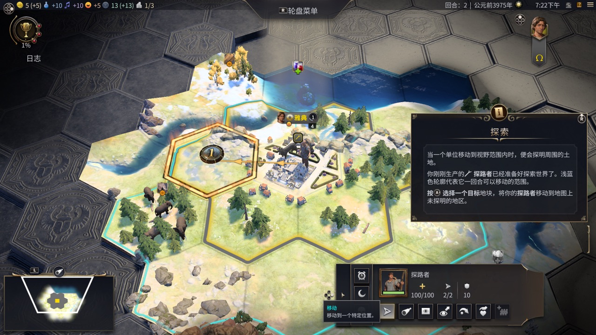
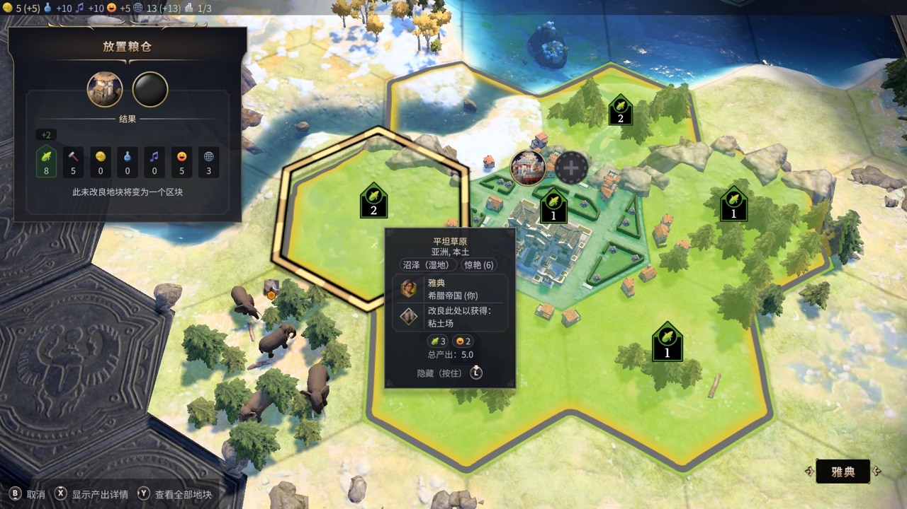

# 文明 7：高亮缺失的绘制级取证与 BRX 修复

2026-11-08 晚更新，承接[移植全过程](civ7.zh-CN.md)。本次修复已部署到本地 Mac；本文的教程提交不代表 nxnative 上游已合并实现补丁。

## 现状与验证范围

| 场景 | 结果 |
| --- | --- |
| 地图悬停 / 选中高亮 | 已实测恢复；金色六边形框跟随光标，路线箭头与移动成本可见 |
| 建筑放置 | 已实测粮仓选中框恢复；确认地块后施工模型正常显示 |
| 城市购地 | 共用缺陷已修复，但具体界面未单独验收，由用户核对 |
| MSAA 上传 | 已恢复到当前宿主；不能据此认定它是高亮的根因 |

测试使用存档副本，原存档未改动。桌面启动器已同步，调用当前自包含目录的 `run.sh`；旧宿主保留备份。

## 早期判断为什么不够

双源入口、VS/FS 配对、varying 补齐确实解决了相关混合或接口问题，但并没有证明高亮可见。补齐 varying 要保留 `flat` 等限定词；本次零值槽对应原始 `MOV.U ... {0,0,0,0}`，不能把 `(0,0,0,1)` 当作这个槽的实际值。零值 varying 漏译本身仍待正修。

1. 用 `DM_NVN_PASSDUMP_ALL=1`、`DM_NVN_CBDUMP=<dir>` 及控制文件命令 `passdump 1`、`texdump <path_%d.png>` 抓取每个 draw 的目标与绑定。
2. 1504×1504 地块覆盖层与 128×128 边缘遮罩已有内容，遮罩生成路径并未整体缺失。
3. 先前关注的 `064c…` / `f275…` 管线在常规场景也执行，不能仅凭旧链接错误认定它们就是缺失特效。
4. 原生捕获 `DM_NVN_VSDUMP_KEY=708b9969b7df9d22`、`DM_NVN_VSDUMP=<file>` 显示，一次四顶点绘制的四个输出位置完全相同，图元面积为零。
5. 对应反射记录的 `notes` 包含以下语义丢失，尽管构建返回成功：

```text
translator: Failed to find targets for BRX instruction at 0x3BA8.
```

## 根因与修复

文件：`dm/third_party/ryujinx/src/Ryujinx.Graphics.Shader/Decoders/Block.cs`；方法：`Split`。

拆基本块后，后半块接管了原块的 `Successors`，但后继的 `Predecessors` 仍指向旧前半块。BRX 跳转表推断沿反向边查寄存器定义，错误地追到入口块的 `ISCADD`，漏过真正的 `LDC → SHL → IMNMX` 序列；翻译器随后漏掉间接跳转。

在转移出边后、清空原块出边前，同步更新反向连接：

```csharp
rightBlock.Successors.AddRange(Successors);
rightBlock.Predecessors.Add(this);
foreach (Block successor in rightBlock.Successors)
{
    for (int i = 0; i < successor.Predecessors.Count; i++)
    {
        if (successor.Predecessors[i] == this)
            successor.Predecessors[i] = rightBlock;
    }
}
```

这是通用 CFG 修复，没有按游戏 ID 特判，也没有关闭效果。清空寄存器搜索 visited 集合的实验未修好该着色器，已经撤回。

部署顺序：重建翻译器 → 更新工具锁与链头 → 重建游戏着色器 → 重建匹配链版本的宿主 → 用存档副本做视觉验收。只替换 DLL 或看到管线成功都不算完成。

## 验证证据

- 独立基本块分裂检查：旧 DLL 失败，修复版通过；现有控制流测试 7/7 通过。
- 游戏着色器 481/481 构建成功，无 silently lost features。三个顶点库发生变化：`0c82ccba9272344b`、`3cc08b03cda3e92e`、`708b9969b7df9d22`，原先均有 BRX 目标丢失。
- 修复后的原生捕获中，四个顶点从重合恢复成正常展开的四边形；同一存档的金色选中框恢复可见。
- 当前本地链为 `666ae0c13535`，同时恢复 MSAA 上传；日常启动仍用 `DM_PRESENT_LINK=0` 绕过 present 首传线程问题。





城市购地具体场景、跨游戏回归、时代过渡视频、iPhone 内存布局仍待验收；present 上传互斥化、零值 varying、CIVBSF S2–S5 配对表解析仍待正修。音频偶发回调超时继续观察。
